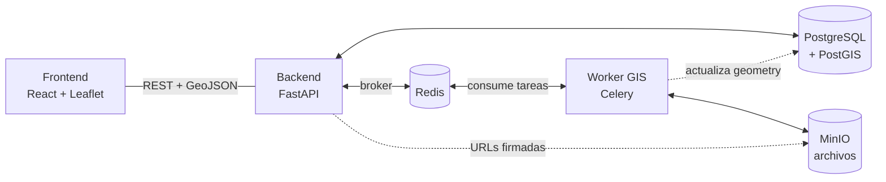

# AgroNexo

[](https://github.com/universoparalelo/Agronexo/actions/workflows/ci.yml)

Plataforma de agricultura de precisión para el NEA argentino (Chaco, Formosa, Corrientes). Procesa imágenes satelitales y de drones (GeoTIFF multiespectrales), calcula índices de vegetación (NDVI, GNDVI, SAVI, NDRE, EVI, MSAVI) y genera diagnósticos agronómicos con prescripción diferenciada por zona.

## Contenido

- [Arquitectura](#arquitectura)
- [Stack](#stack)
- [Decisiones técnicas clave](#decisiones-técnicas-clave)
- [Instalación](#instalación)
- [Servicios y puertos](#servicios-y-puertos)
- [Flujo principal de la API](#flujo-principal-de-la-api)
- [Estructura del proyecto](#estructura-del-proyecto)
- [Despliegue en producción](#despliegue-en-producción)

---

## Arquitectura



El procesamiento de GeoTIFF **nunca ocurre en FastAPI**: siempre se encola en Celery y lo ejecuta el Worker GIS en un contenedor separado, con su propia imagen (`osgeo/gdal`). Esto evita que archivos grandes (> 500 MB) bloqueen la API y permite reintentos automáticos. PostGIS guarda vectores y metadatos; MinIO guarda binarios (GeoTIFF, PDF, SHP) detrás de URLs firmadas de acceso temporario.

## Stack

### Backend
| Tecnología | Rol |
|---|---|
| **FastAPI** | API REST, routing, coordinación de tareas |
| **SQLAlchemy + GeoAlchemy2** | ORM con soporte de geometrías PostGIS |
| **Alembic** | Migraciones de base de datos versionadas |
| **python-jose + passlib/bcrypt** | JWT stateless + hashing de contraseñas |
| **Celery + Redis** | Cola de tareas asíncronas (broker db 0, result backend db 1) |
| **WeasyPrint** | Generación de reportes PDF desde HTML/CSS |

### Worker GIS
| Tecnología | Rol |
|---|---|
| **Rasterio** | Lectura de bandas, windowed reading para archivos grandes, vectorización |
| **NumPy** | Cálculo de índices pixel a pixel sobre arrays completos |
| **GDAL** | Motor geoespacial base (dependencia de Rasterio) |
| **scikit-image** | Umbralización Otsu para clasificación de zonas |
| **GeoPandas + Shapely** | Manipulación vectorial, cálculo de métricas de forma, exportación GeoJSON |

### Datos
| Tecnología | Rol |
|---|---|
| **PostgreSQL + PostGIS** | Metadatos y geometrías vectoriales con índices GiST |
| **MinIO** | Archivos binarios (GeoTIFF, PDF, SHP) — S3-compatible |

### Frontend
| Tecnología | Rol |
|---|---|
| **React + Vite** | UI principal, hot reload en desarrollo |
| **React-Leaflet** | Mapas, capas GIS, polígonos GeoJSON |
| **CSS plano** | Estilos (Tailwind previsto para un sprint posterior) |

## Decisiones técnicas clave

- **Worker GIS en contenedor separado** — el procesamiento de rasters grandes consume mucha RAM/CPU durante minutos; correrlo en FastAPI bloquearía la API.
- **PostGIS + MinIO, no todo en disco** — PostGIS habilita consultas espaciales (`ST_Intersects`, `ST_Contains`) con índices GiST; MinIO evita que binarios grandes vivan en la base.
- **Redis con `result_backend` propio** — Celery necesita un backend de resultados (db 1) además del broker (db 0); sin él, el polling de progreso siempre devuelve `PENDING`.
- **Soft delete, nunca `DELETE` físico** — lotes, vuelos y análisis usan `deleted_at`, para poder distinguir patrones edáficos permanentes de episódicos entre campañas.

## Instalación

**Requisito único:** [Docker Desktop](https://docs.docker.com/desktop/) (incluye Compose). Todo lo demás corre en contenedores. En Windows, la instalación pide habilitar WSL 2 — es necesario.

```bash
git clone <url-del-repo>
cd agronexo
cp .env.example .env
```

Completá `.env` con los valores indicados. Para generar el JWT secret:

```bash
# Mac / Linux
openssl rand -hex 32

# Windows (PowerShell)
python -c "import secrets; print(secrets.token_hex(32))"
```

Levantá el stack y corré las migraciones:

```bash
docker compose up -d --build
docker compose exec api alembic upgrade head
```

Verificá que todo esté sano:

```bash
docker compose ps                              # todos los servicios en "healthy"
curl http://localhost:8000/api/v1/health       # {"status": "ok", "env": "development"}
```

Ingresá a http://localhost:5173 con el usuario administrador por defecto (ver tabla de [servicios](#servicios-y-puertos)).

## Servicios y puertos

| Servicio | URL / Puerto | Descripción |
|---|---|---|
| **Frontend** | http://localhost:5173 | React — usuario `admin@agronexo.com` / contraseña `password123` |
| **API (FastAPI)** | http://localhost:8000 | Backend principal |
| **Docs Swagger** | http://localhost:8000/api/docs | Documentación interactiva de la API |
| **MinIO Console** | http://localhost:9001 | Explorador de archivos (credenciales del `.env`) |
| **PostgreSQL** | `localhost:5432` | Database `agronexo`, usuario `agronexo`, password del `.env` |
| **Redis** | `localhost:6379` | Broker de tareas |

## Flujo principal de la API

```
POST /api/v1/auth/login                              → tokens JWT
POST /api/v1/lotes                                   → crear lote con polígono GeoJSON
POST /api/v1/lotes/{id}/cultivos                     → cargar un cultivo del lote (tipo, variedad, siembra, cosecha)
POST /api/v1/lotes/{id}/vuelos                       → subir GeoTIFF (con cultivo_id o cultivo_tipo…) → encola Celery → 202 Accepted
GET  /api/v1/lotes/{id}/vuelos/{id}/estado           → polling de progreso (%)
GET  /api/v1/lotes/{id}/vuelos/{id}/diagnostico      → diagnóstico agronómico por zona
GET  /api/v1/productos-fitosanitarios                → catálogo de productos (?causa=...&tipo=...)
GET  /api/v1/analisis/{id}/reportes/shapefile        → .zip para maquinaria agrícola
```

Todos los endpoints (excepto `/auth/login` y `/auth/register`) requieren `Authorization: Bearer <token>`.

## Estructura del proyecto

```
agronexo/
├── app/                    # Backend FastAPI
│   ├── auth/               # Registro, login, JWT
│   ├── lotes/              # CRUD de lotes agrícolas con geometrías PostGIS
│   ├── ingesta/            # Upload GeoTIFF, validación, encolado Celery
│   ├── diagnostico/        # Motor de reglas (20 reglas), texto explicativo, severidad, zonificación de manejo
│   ├── reportes/           # PDF (WeasyPrint), Shapefile, ISO-XML
│   ├── catalogo/           # Importador del catálogo de fitosanitarios desde Excel (dosis, precios)
│   ├── core/               # Config (pydantic-settings), BD, cliente MinIO
│   └── main.py             # Punto de entrada FastAPI
├── workers/
│   ├── celery_app.py       # Configuración Celery (broker + result_backend)
│   └── gis/tasks.py        # Pipeline GIS: lectura → índices → vectorización
├── migrations/versions/    # Migraciones Alembic versionadas (0001 → 0026)
├── tests/                  # Pipeline GIS, motor diagnóstico, API
├── frontend/               # React + Vite
├── docker/
│   ├── Dockerfile.api      # Python 3.11 + FastAPI
│   ├── Dockerfile.worker   # osgeo/gdal + Celery + dependencias GIS
│   ├── Dockerfile.nginx    # Producción: build estático del frontend + reverse proxy
│   ├── nginx/nginx.conf    # Config del reverse proxy (HTTP y HTTPS vía Certbot)
│   └── requirements.{api,worker}.txt
├── docker-compose.yml      # Desarrollo
├── docker-compose.prod.yml # Producción (HU-R4-06)
├── .env.example            # Plantilla de variables de entorno de desarrollo (sin valores reales)
├── .env.prod.example       # Plantilla de variables de entorno de producción (sin valores reales)
└── docs/                   # Seguimiento de release y documentación técnica
```

## Despliegue en producción

`docker-compose.prod.yml` difiere del compose de desarrollo en varios puntos clave:

- Sin bind mounts de código — las imágenes se buildean con el código ya copiado adentro; un cambio requiere rebuild, no hot-reload.
- `db`, `redis` y `minio` **no publican puertos al host** — solo son alcanzables desde la red interna de Docker. Para inspeccionarlos desde el servidor usar `docker compose -f docker-compose.prod.yml exec <servicio> ...`, nunca conectarse por IP pública.
- Las migraciones (`alembic upgrade head`) corren automáticamente al arrancar el contenedor `api`, antes de levantar uvicorn — si fallan, el contenedor no levanta.
- El frontend se sirve como build estático (no el dev server de Vite) detrás de un reverse proxy Nginx (`docker/Dockerfile.nginx`), único punto de entrada público.

### Primer despliegue en un servidor nuevo

1. **Provisionar el servidor** (VPS con Docker y Docker Compose instalados).
2. **Clonar el repo** y copiar `.env.prod.example` a `.env.prod`:
   ```bash
   cp .env.prod.example .env.prod
   ```
3. **Completar `.env.prod` con valores reales** — ningún placeholder `REEMPLAZAR_*` puede quedar sin cambiar. Generar secretos con:
   ```bash
   openssl rand -hex 32   # JWT_SECRET_KEY
   openssl rand -hex 24   # POSTGRES_PASSWORD, MINIO_ROOT_PASSWORD, ADMIN_PASSWORD
   ```
4. **Levantar el stack** (primer arranque: sin dominio todavía, Nginx sirve solo HTTP):
   ```bash
   docker compose -f docker-compose.prod.yml up -d --build
   ```
5. **Verificar que levantó sano**:
   ```bash
   docker compose -f docker-compose.prod.yml ps
   curl http://<IP_PUBLICA>/api/v1/health
   ```
6. **Apuntar el dominio** (registro DNS tipo A) a la IP pública del servidor, y esperar a que propague.
7. **Emitir el certificado HTTPS** (reemplazar `DOMINIO_AQUI` y el email real):
   ```bash
   docker compose -f docker-compose.prod.yml run --rm certbot certonly \
     --webroot -w /var/www/certbot \
     -d DOMINIO_AQUI --email REEMPLAZAR_email --agree-tos --no-eff-email
   ```
8. **Activar HTTPS**: descomentar los bloques `server { listen 443 ... }` y el redirect HTTP→HTTPS en `docker/nginx/nginx.conf` (reemplazando `DOMINIO_AQUI`), y recrear el servicio `nginx`:
   ```bash
   docker compose -f docker-compose.prod.yml up -d --build nginx
   ```
9. **Firewall del servidor** — dejar accesibles desde internet solo 80/443; restringir 22 (SSH) a IPs conocidas si es posible; verificar que 5432/6379/9000-9001 no respondan desde afuera (`nmap <IP_PUBLICA>` desde otra máquina, o simplemente confirmar que no están en ningún `ports:` del compose de producción — ya es el caso).
10. **Backups** — instalar el cron en el servidor (`crontab -e`), ejecutando desde la raíz del repo:
    ```cron
    0 3 * * *  cd /ruta/al/repo && ./scripts/backup_postgres.sh >> backups/postgres/backup.log 2>&1
    30 3 * * * cd /ruta/al/repo && ./scripts/backup_minio.sh >> backups/minio/backup.log 2>&1
    ```
    `scripts/backup_postgres.sh` corre `pg_dump` vía `docker compose exec` y guarda el `.sql.gz` en `backups/postgres/` (conserva los últimos 14 días). `scripts/backup_minio.sh` usa `mc mirror` dentro del propio contenedor `minio` hacia `backups/minio/` (mismo criterio de retención) — los GeoTIFF originales no se pueden recalcular, así que este backup no es opcional. Ambos scripts leen `.env.prod`, así que hay que correrlos desde la raíz del repo en el servidor.

### Deploys siguientes (código ya en el servidor)

```bash
git pull origin main
docker compose -f docker-compose.prod.yml up -d --build
```

Las migraciones corren solas como parte del arranque del contenedor `api` — no hace falta correr `alembic upgrade head` a mano.
