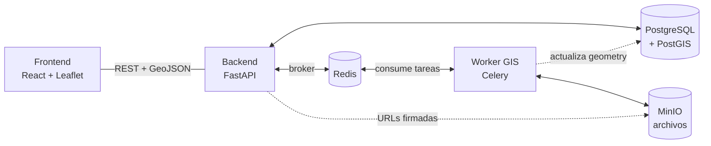

# AgroNexo

[](https://github.com/universoparalelo/Agronexo/actions/workflows/ci.yml)

Plataforma de agricultura de precisión para el NEA argentino (Chaco, Formosa, Corrientes). Procesa imágenes satelitales y de drones (GeoTIFF multiespectrales), calcula índices de vegetación (NDVI, GNDVI, SAVI, NDRE, EVI, MSAVI) y genera diagnósticos agronómicos con prescripción diferenciada por zona.

## Contenido

- [Arquitectura](#arquitectura)
- [Stack](#stack)
- [Decisiones técnicas clave](#decisiones-técnicas-clave)
- [Instalación](#instalación)
- [Servicios y puertos](#servicios-y-puertos)
- [Flujo principal de la API](#flujo-principal-de-la-api)
- [Estructura del proyecto](#estructura-del-proyecto)

---

## Arquitectura



El procesamiento de GeoTIFF **nunca ocurre en FastAPI**: siempre se encola en Celery y lo ejecuta el Worker GIS en un contenedor separado, con su propia imagen (`osgeo/gdal`). Esto evita que archivos grandes (> 500 MB) bloqueen la API y permite reintentos automáticos. PostGIS guarda vectores y metadatos; MinIO guarda binarios (GeoTIFF, PDF, SHP) detrás de URLs firmadas de acceso temporario.

## Stack

### Backend
| Tecnología | Rol |
|---|---|
| **FastAPI** | API REST, routing, coordinación de tareas |
| **SQLAlchemy + GeoAlchemy2** | ORM con soporte de geometrías PostGIS |
| **Alembic** | Migraciones de base de datos versionadas |
| **python-jose + passlib/bcrypt** | JWT stateless + hashing de contraseñas |
| **Celery + Redis** | Cola de tareas asíncronas (broker db 0, result backend db 1) |
| **WeasyPrint** | Generación de reportes PDF desde HTML/CSS |

### Worker GIS
| Tecnología | Rol |
|---|---|
| **Rasterio** | Lectura de bandas, windowed reading para archivos grandes, vectorización |
| **NumPy** | Cálculo de índices pixel a pixel sobre arrays completos |
| **GDAL** | Motor geoespacial base (dependencia de Rasterio) |
| **scikit-image** | Umbralización Otsu para clasificación de zonas |
| **GeoPandas + Shapely** | Manipulación vectorial, cálculo de métricas de forma, exportación GeoJSON |

### Datos
| Tecnología | Rol |
|---|---|
| **PostgreSQL + PostGIS** | Metadatos y geometrías vectoriales con índices GiST |
| **MinIO** | Archivos binarios (GeoTIFF, PDF, SHP) — S3-compatible |

### Frontend
| Tecnología | Rol |
|---|---|
| **React + Vite** | UI principal, hot reload en desarrollo |
| **React-Leaflet** | Mapas, capas GIS, polígonos GeoJSON |
| **CSS plano** | Estilos (Tailwind previsto para un sprint posterior) |

## Decisiones técnicas clave

- **Worker GIS en contenedor separado** — el procesamiento de rasters grandes consume mucha RAM/CPU durante minutos; correrlo en FastAPI bloquearía la API.
- **PostGIS + MinIO, no todo en disco** — PostGIS habilita consultas espaciales (`ST_Intersects`, `ST_Contains`) con índices GiST; MinIO evita que binarios grandes vivan en la base.
- **Redis con `result_backend` propio** — Celery necesita un backend de resultados (db 1) además del broker (db 0); sin él, el polling de progreso siempre devuelve `PENDING`.
- **Soft delete, nunca `DELETE` físico** — lotes, vuelos y análisis usan `deleted_at`, para poder distinguir patrones edáficos permanentes de episódicos entre campañas.

## Instalación

**Requisito único:** [Docker Desktop](https://docs.docker.com/desktop/) (incluye Compose). Todo lo demás corre en contenedores. En Windows, la instalación pide habilitar WSL 2 — es necesario.

```bash
git clone <url-del-repo>
cd agronexo
cp .env.example .env
```

Completá `.env` con los valores indicados. Para generar el JWT secret:

```bash
# Mac / Linux
openssl rand -hex 32

# Windows (PowerShell)
python -c "import secrets; print(secrets.token_hex(32))"
```

Levantá el stack y corré las migraciones:

```bash
docker compose up -d --build
docker compose exec api alembic upgrade head
```

Verificá que todo esté sano:

```bash
docker compose ps                              # todos los servicios en "healthy"
curl http://localhost:8000/api/v1/health       # {"status": "ok", "env": "development"}
```

Ingresá a http://localhost:5173 con el usuario administrador por defecto (ver tabla de [servicios](#servicios-y-puertos)).

## Servicios y puertos

| Servicio | URL / Puerto | Descripción |
|---|---|---|
| **Frontend** | http://localhost:5173 | React — usuario `admin@agronexo.com` / contraseña `password123` |
| **API (FastAPI)** | http://localhost:8000 | Backend principal |
| **Docs Swagger** | http://localhost:8000/api/docs | Documentación interactiva de la API |
| **MinIO Console** | http://localhost:9001 | Explorador de archivos (credenciales del `.env`) |
| **PostgreSQL** | `localhost:5432` | Database `agronexo`, usuario `agronexo`, password del `.env` |
| **Redis** | `localhost:6379` | Broker de tareas |

## Flujo principal de la API

```
POST /api/v1/auth/login                              → tokens JWT
POST /api/v1/lotes                                   → crear lote con polígono GeoJSON
POST /api/v1/lotes/{id}/cultivos                     → cargar un cultivo del lote (tipo, variedad, siembra, cosecha)
POST /api/v1/lotes/{id}/vuelos                       → subir GeoTIFF (con cultivo_id o cultivo_tipo…) → encola Celery → 202 Accepted
GET  /api/v1/lotes/{id}/vuelos/{id}/estado           → polling de progreso (%)
GET  /api/v1/lotes/{id}/vuelos/{id}/diagnostico      → diagnóstico agronómico por zona
GET  /api/v1/productos-fitosanitarios                → catálogo de productos (?causa=...&tipo=...)
GET  /api/v1/analisis/{id}/reportes/shapefile        → .zip para maquinaria agrícola
```

Todos los endpoints (excepto `/auth/login` y `/auth/register`) requieren `Authorization: Bearer <token>`.

## Estructura del proyecto

```
agronexo/
├── app/                    # Backend FastAPI
│   ├── auth/               # Registro, login, JWT
│   ├── lotes/              # CRUD de lotes agrícolas con geometrías PostGIS
│   ├── ingesta/            # Upload GeoTIFF, validación, encolado Celery
│   ├── diagnostico/        # Motor de reglas (20 reglas), texto explicativo, severidad, zonificación de manejo
│   ├── reportes/           # PDF (WeasyPrint), Shapefile, ISO-XML
│   ├── core/               # Config (pydantic-settings), BD, cliente MinIO
│   └── main.py             # Punto de entrada FastAPI
├── workers/
│   ├── celery_app.py       # Configuración Celery (broker + result_backend)
│   └── gis/tasks.py        # Pipeline GIS: lectura → índices → vectorización
├── migrations/versions/    # Migraciones Alembic versionadas (0001 → 0020)
├── tests/                  # Pipeline GIS, motor diagnóstico, API
├── frontend/               # React + Vite
├── docker/
│   ├── Dockerfile.api      # Python 3.11 + FastAPI
│   ├── Dockerfile.worker   # osgeo/gdal + Celery + dependencias GIS
│   └── requirements.{api,worker}.txt
├── docker-compose.yml
├── .env.example            # Plantilla de variables de entorno (sin valores reales)
└── docs/                   # Seguimiento de release y documentación técnica
```
