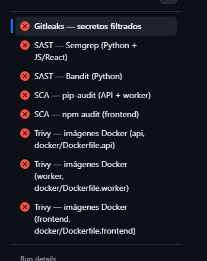

# Release v4.0.0 — Seguimiento

**Estado:** En desarrollo
**Rama principal:** `main`
**Inicio:** Sprint 14

---

## Sprint 14 — CI/CD: seguridad (SAST, SCA, secretos, imágenes)

**Período:** 2026-09-27

### Tareas completadas

| Tarea | Estado |
|---|---|
| Workflow `security.yml`: SAST (Semgrep + Bandit) | Completada |
| Workflow `security.yml`: SCA (pip-audit + npm audit) | Completada |
| Workflow `security.yml`: escaneo de secretos (Gitleaks) | Completada |
| Workflow `security.yml`: escaneo de imágenes Docker (Trivy) | Completada |
| `dependabot.yml` (pip, npm, docker, github-actions) | Completada |
| Escaneo de secretos sobre todo el historial (una sola vez) | Completada — ver hallazgo abajo |
| Reemplazar la imagen de MinIO en `docker-compose.yml` (`minio/minio` dado de baja) | Completada |
| Bumps validados: `redis`, `weasyprint`, `pyshp`, `geotiff`, `node` (Grupo E de Dependabot) | Completada |
| HU-R4-01 — fix IDOR en endpoints de índices adicionales del vuelo | Completada |
| Upgrade `react`/`react-dom` 19, `react-leaflet` 5, `react-router-dom` 7 | Completada |
| HU-R4-02 — trazabilidad completa del análisis | Completada |
| Fix: label engañoso "Procesando imagen" en Vista geoespacial del Dashboard | Completada |
| HU-R4-03 — listado multi-lote con filtros, paginado y fix de N+1 | Completada |
| HU-R4-06 — base de despliegue en producción (compose, Nginx/HTTPS, migraciones, credenciales) | Completada — parcial, ver detalle |

#### Workflow de seguridad separado de `ci.yml`
**Fecha:** 2026-09-27
**Rama:** `feat/ci-seguridad-sast-sca`

El pipeline de CI (`ci.yml`) solo corría tests funcionales (API, worker GIS, build de frontend) — no había ningún control de seguridad: sin SAST, sin SCA, sin escaneo de secretos ni de imágenes Docker, y sin Dependabot para automatizar el parcheo de dependencias vulnerables.

Se agregó `.github/workflows/security.yml` con 6 jobs independientes:
- **Gitleaks** (secretos) — corre sobre el historial completo del push/PR (`fetch-depth: 0`), no solo el diff.
- **Semgrep** (SAST) — reglas `p/security-audit` + `p/owasp-top-ten` + `p/secrets`, cubre Python y JS/React en un solo job.
- **Bandit** (SAST) — reglas específicas de Python sobre `app/` y `workers/`, complementa a Semgrep con menos falsos negativos en patrones típicos de Python (shell=True, eval, etc.).
- **pip-audit** (SCA) — audita `docker/requirements.api.txt` y `docker/requirements.worker.txt` contra la base OSV/PyPI.
- **npm audit** (SCA) — `npm ci` + `npm audit --audit-level=high` en `frontend/`.
- **Trivy** (imágenes) — matriz que buildea las 3 imágenes (`api`, `worker`, `frontend`) con los Dockerfiles reales de `docker/` y escanea CVEs `CRITICAL`/`HIGH` del SO base.

**Decisiones tomadas:**
- **Workflow separado de `ci.yml`, no un job más ahí:** son gates con dueños y cadencia de revisión distintos (calidad funcional vs. seguridad); separarlos permite tunear o silenciar reglas de seguridad sin tocar el pipeline de tests, y que un fallo de seguridad no bloquee el feedback rápido de tests en cada push.
- **`continue-on-error: true` en todos los jobs nuevos excepto Gitleaks**, como rollout inicial: Semgrep/Bandit/pip-audit/npm-audit/Trivy corren y reportan pero no bloquean merges todavía, para poder ver el volumen real de hallazgos (probablemente hay ruido en un repo que nunca corrió estas herramientas) sin frenar el equipo de un día para el otro. Gitleaks sí bloquea desde el día uno porque un secreto filtrado es una categoría de riesgo distinta (binario: está o no está, no hay "falso positivo aceptable" razonable por defecto).
- **No se subieron resultados SARIF al tab de Security de GitHub** — esa integración nativa (`github/codeql-action/upload-sarif`) requiere GitHub Advanced Security en repos privados; queda pendiente evaluarla si la org licencia GHAS o si el repo pasa a público.
- **Trivy escanea las imágenes reales del proyecto** (build con los `Dockerfile.*` de `docker/`, mismo contexto que usa `docker-compose.yml`) en vez de solo un `trivy fs` sobre los manifiestos de dependencias — cubre CVEs del sistema operativo base (`node:20-slim`, la imagen GDAL) que pip-audit/npm audit no ven.
- **Trigger con `schedule` semanal** (lunes 06:00 UTC) además de push/PR — para detectar CVEs nuevos publicados sobre dependencias que no cambiaron, ya que Dependabot corre en un ciclo separado y solo actúa cuando hay una versión parcheada disponible.
- **`dependabot.yml`** cubre 4 ecosistemas: `pip` (`/docker`, agrupa API+worker porque ambos requirements viven ahí), `npm` (`/frontend`), `docker` (imágenes base de los 3 Dockerfiles) y `github-actions` (el propio pipeline de CI, para no quedar con acciones desactualizadas silenciosamente).

**Hallazgo — 4 secretos reales en el historial de git (no en el código actual)**

El escaneo con el historial completo (`gitleaks detect --source . --verbose`, corrido localmente antes de confiar en el gate de CI) encontró un `access_token`/`refresh_token` de ejemplo pegados en `docs/docs/Arquitectura.md` y `docs/sprint1y2.md` en el commit `de3e308` (2026-06-23, autor `universoparalelo`). Ambos archivos ya no existen en el árbol actual, pero el secreto sigue siendo recuperable por cualquiera que clone el repo (está en el historial, no solo en el HEAD).

**Riesgo evaluado como bajo pero no nulo:** por la config de auth del proyecto (`ACCESS_TOKEN_EXPIRE_MINUTES=30`, `REFRESH_TOKEN_EXPIRE_DAYS=7`) y la fecha del commit (~3 meses antes de este sprint), ambos tokens ya vencieron — no son explotables hoy. No se filtró el `JWT_SECRET_KEY` en sí (eso sí habría sido crítico, porque permite firmar tokens nuevos indefinidamente), solo instancias de tokens ya vencidas.

**Decisión final (2026-09-27): no se reescribe el historial.** Evaluado con el equipo — reescribir (`git filter-repo`/BFG + force-push) es una operación de alto impacto sobre una rama compartida (obliga a todo el equipo a re-clonar o resetear su copia local) para eliminar dos tokens que ya vencieron hace meses y no exponen el `JWT_SECRET_KEY`. El riesgo remanente no justifica esa disrupción. El `.gitleaksignore` agregado en este sprint (con los 4 fingerprints exactos) queda como mitigación permanente, no transitoria: el gate de CI sigue viendo el historial completo en cada corrida pero no vuelve a fallar por un hallazgo ya evaluado y aceptado.

#### Fixes tras el primer PR real (#20) — 4 bugs del workflow expuestos por CI real
**Fecha:** 2026-09-27
**Rama:** `feat/ci-seguridad-sast-sca`

El primer push a PR abrió los ojos sobre varias cosas que solo se ven corriendo en GitHub Actions de verdad (no hay forma de simular el runner completo en local):

- **`aquasecurity/trivy-action@0.28.0` no resolvía** — el tag real lleva prefijo `v` (`v0.28.0`). Verificado contra la API de tags del repo (`api.github.com/repos/aquasecurity/trivy-action/tags`).
- **Gitleaks fallaba con 403 "Resource not accessible by integration"** al listar los commits del PR — el `GITHUB_TOKEN` por defecto del repo no incluye `pull-requests: read`. Se agregó `permissions` explícito al job (mínimo privilegio: `contents: read` a nivel workflow, `pull-requests: read` solo en el job de secretos).
- **`npm ci` fallaba** porque `frontend/package-lock.json` estaba desincronizado con `package.json` (le faltaban `geotiff`/`proj4` y sus transitivas, agregadas en el Sprint 13). Nadie lo había notado porque ni `Dockerfile.frontend` ni el job `build-frontend` de `ci.yml` usan `npm ci` — ambos usan `npm install`, que regenera el lock silenciosamente en vez de fallar. Regenerado con `npm install` (diff de 121 líneas, solo lo faltante).
- **El propio `trivy-action` fallaba después de corregir el tag** — el instalador embebido de la action (`contrib/install.sh` de aquasecurity/trivy) fallaba con exit code 1 sin mensaje de error legible después de resolver la versión (`v0.64.1`), de forma reproducible en las 3 imágenes. Es un problema conocido de esa action con el script instalador, no de esta config. **Se reemplazó por `docker run aquasec/trivy:0.74.0 image ...` directo** montando el socket de Docker del runner — evita el instalador por completo y ya se probó en local contra una imagen real antes de subirlo.

**Decisión tomada:** no se relajó ningún check para "hacerlo pasar" — Bandit, Semgrep, pip-audit y npm audit siguen en rojo en el PR porque encontraron hallazgos reales (no bugs de config), y quedan así a propósito mientras dure el rollout en modo reporte (`continue-on-error`).

#### Triage de los primeros hallazgos reales — 3 arreglos baratos
**Fecha:** 2026-09-27
**Rama:** `feat/ci-seguridad-sast-sca`

Con el workflow ya corriendo bien (sin bugs de config), tocaba decidir qué hacer con los hallazgos reales de la primera corrida. En vez de ajustar el pipeline para "que pase en verde", se clasificaron por costo real:

- **`python-multipart` 0.0.20 → 0.0.32** (`docker/requirements.api.txt`): parcheaba 6 CVEs (PYSEC-2026-3036 a -3040, -1852). Es la librería que procesa la subida de GeoTIFF (`multipart/form-data`), así que no era un CVE cualquiera. Bump de patch, sin cambios de código. Validado con `tests/test_ingesta.py` (4), `tests/test_lotes.py` + `tests/test_vuelos_estado.py` (34) — los 3 suites pasan igual.
- **`npm audit fix` (sin `--force`) en `frontend/`**: resolvió `postcss` solo (diff de 42 líneas en `package-lock.json`, `package.json` sin cambios). Verificado con `npm run build` y `npm test` (vitest, 9 tests) — ambos OK.
- **Bandit B310 en `workers/gis/satelital_catalogo.py::_get_json`**: falso positivo — Bandit marca cualquier `urlopen()` sin distinguir que acá el scheme+host siempre sale de `EARTH_SEARCH_COLLECTION_URL` (constante fija del módulo); las dos llamadas del módulo solo varían el path/query, nunca pueden apuntar a `file://` ni a otro host. Se documentó con un comentario explicando el porqué + `# nosec B310` en la línea. Confirmado con Bandit local: `No issues identified` (antes: 1 Medium).

**Lo que quedó afuera a propósito (no es "barato"):**
- `react-router-dom`: el audit sugiere `npm audit fix`, pero el fix real es saltar de v6.28 a v7.18 (major, breaking) — no se fuerza sin una tarea de testing de rutas aparte.
- `starlette` (CVEs varios, ver hallazgo de pip-audit): viene empaquetado por el pin de `fastapi==0.115.6`; arreglarlo de verdad implica subir FastAPI a una versión que soporte un Starlette parchado — riesgo de romper comportamiento, requiere correr toda la suite, no un bump aislado. Queda como problema abierto.
- `pytest` 8.3.4 → 9.x: dependencia solo de test (no llega a producción); major version bump, puede romper config de tests. Sin apuro.
- `ecdsa` (PYSEC-2026-1325, sin versión con fix — el maintainer no lo va a parchear, es un problema conocido de canal lateral): dependencia transitoria de `python-jose[cryptography]`, pero el proyecto firma JWT con `HS256` (`app/auth/dependencies.py`, `app/auth/router.py` — `jwt.decode(..., algorithms=[settings.jwt_algorithm])`), nunca con `ES256`. El código de `ecdsa` no se ejecuta en ningún camino real de la app — riesgo aceptado, no se persigue un CVE sin fix disponible.

#### Pinear las GitHub Actions a un commit SHA + acotar `JWT_SECRET_KEY` a los jobs que lo usan
**Fecha:** 2026-09-27
**Rama:** `feat/ci-seguridad-sast-sca`

Resolvió los últimos 2 grupos de hallazgos de Semgrep (17 → 0):

- **`github-actions-mutable-action-tag` (17)**: las 4 acciones usadas (`actions/checkout`, `actions/setup-python`, `actions/setup-node`, `gitleaks/gitleaks-action`) se resolvieron a su commit SHA exacto vía `gh api repos/<owner>/<repo>/git/refs/tags/<tag>` y se pinearon en `ci.yml` y `security.yml`, con el tag legible como comentario (`@11d5960a...262 # v4.4.0`). `dependabot.yml` (ecosistema `github-actions`, ya agregado en este sprint) va a mantener esos SHA actualizados solo.
- **`gha-workflow-env-secret` (1, `ci.yml:27`)**: `JWT_SECRET_KEY` salió del `env:` a nivel workflow (donde lo veían los 3 jobs, incluido `build-frontend` que ni lo usa) y se movió al `env:` de cada job que sí lo necesita — `test-api` sigue usando `secrets.CI_JWT_SECRET_KEY` (con el mismo fallback de siempre) porque ahí sí se firman/verifican JWTs de verdad; `test-gis` pasó a un string fijo sin referenciar el secret real, porque solo necesita que el campo requerido de `Settings` no esté vacío, nunca firma nada.

Verificado con Semgrep local: `Ran 350 rules on 196 files: 0 findings` (antes: 25). Los 3 jobs de `ci.yml` no se tocaron en su lógica, solo el `env:`.

#### Bump de `pytest` 8.3.4 → 9.1.1
**Fecha:** 2026-09-27
**Rama:** `feat/ci-seguridad-sast-sca`

Resuelve el hallazgo PYSEC-2026-1845 de `pip-audit`. Es dependencia solo de test (no llega a producción), pero igual se corrió la suite completa antes de dar el bump por bueno: **313 tests pasan** (237 en la imagen `api`, 25 archivos `tests/test_*.py` menos `test_celery_integracion.py` que necesita el stack completo con MinIO — ver hallazgo abajo; 76 en la imagen `worker`, los que importan `rasterio`/`numpy`/`geopandas`). Sin cambios de código — pytest 9 no rompió nada de lo que usa este repo.

**Nota sobre cómo se corrió:** las imágenes se reconstruyeron desde cero (`docker compose build`) porque un reinicio de emergencia de la máquina había limpiado todo el estado de Docker Desktop (cero imágenes, contenedores y volúmenes). `docker compose up` no pudo levantar `api`/`worker` completos porque ambos tienen `depends_on: minio: condition: service_healthy` y MinIO no arranca (ver hallazgo siguiente) — se corrieron los tests con `docker run` directo contra la red de Compose (`--network agronexo_default`), sin pasar por el chequeo de salud de `minio`.

#### Hallazgo — `minio/minio` ya no se puede bajar sin cuenta (Docker Hub y quay.io)
**Fecha:** 2026-09-27

Al reconstruir el stack desde cero, `docker compose up` falló en seco: `Error response from daemon: pull access denied for minio/minio, repository does not exist or may require 'docker login'`. No es un problema de esta máquina ni de este repo — MinIO dejó de publicar `minio/minio` en Docker Hub, y su alternativa (`quay.io/minio/minio`) ahora exige autenticación incluso para tags viejos (`RELEASE.2025-04-22T22-12-26Z` probado, mismo 401). Confirmado también vía la API pública de Docker Hub: `GET /v2/repositories/minio/minio/` → `{"message":"object not found"}`.

**Impacto:** cualquiera que clone el repo hoy y corra `docker compose up` desde cero no puede levantar `api`, `worker` ni `frontend` con conexión a MinIO real — todos dependen de `minio: condition: service_healthy`. El único workaround usado en este sprint (`docker run` directo contra la red de Compose) evita el problema para correr tests, pero no es una solución para el flujo normal de desarrollo (`docker compose up`).

**El CI de GitHub Actions no se ve afectado** (verificado, no es una suposición): ni `ci.yml` ni `security.yml` dependen de `docker compose` ni de la imagen de MinIO. `test-api`/`test-gis` levantan Postgres/Redis como `services:` nativos de GitHub Actions e instalan las dependencias con `pip install` directo en el runner; Trivy en `security.yml` hace `docker build` de cada Dockerfile individual, que tampoco usa MinIO como base. El único test que necesita MinIO real (`test_celery_integracion.py`, el E2E) ya estaba excluido de CI desde antes de este sprint — solo corre manualmente con `docker compose exec worker`.

**Investigación de alternativas gratis (2026-09-27):** confirmado con múltiples fuentes independientes, no es un problema de esta máquina ni transitorio:
- El 11 de septiembre de 2026 MinIO borró `minio/minio` y `minio/mc` de Docker Hub por completo.
- Desde el 24 de septiembre, `quay.io/minio/minio` también rechaza pulls anónimos — probado localmente contra un tag viejo (`RELEASE.2025-04-22T22-12-26Z`), mismo 401. Ni siquiera el último release "congelado" antes del cambio (`RELEASE.2025-09-07`) queda accesible sin cuenta.
- Es una decisión de negocio de MinIO: empujar a todos hacia su producto pago (AIStor), discontinuando las imágenes gratis de la edición community.
- **Alternativa gratis probada y funcional:** `cgr.dev/chainguard/minio:latest` — se puede bajar sin login, corrida localmente respondió `200` en `/minio/health/live` con una versión reciente (`RELEASE.2026-09-22T19-25-18Z`), no una imagen vieja congelada. Es el mismo binario de MinIO (misma API S3), solo cambia el registro/imagen. Contra: es una imagen "distroless" (sin shell adentro, no se puede hacer `docker exec -it ... sh` para debuggear).
- Otras alternativas evaluadas pero no probadas: SeaweedFS/Garage (S3-compatible pero no es MinIO, cambio de producto), LocalStack (pensado para mockear S3 en tests, no como backend persistente de desarrollo), compilar MinIO desde su fuente AGPLv3 en GitHub (gratis pero con mantenimiento propio).
- Fuentes: [Minimus — MinIO Docker Image Changes](https://www.minimus.io/post/minio-docker-image-changes-how-to-find-a-secure-minio-alternative), [bex.co — MinIO Vanished From Docker Hub](https://bex.co/blog/2026/09/25/minio-docker-hub-removal-quay-repoint), [byteiota — MinIO Is Gone From Docker Hub and Quay.io](https://byteiota.com/minio-docker-hub-quay-anonymous-pull-fix/), [GitHub — CloudTAK#1803](https://github.com/dfpc-coe/CloudTAK/issues/1803).

**Sin resolver a propósito:** no se tocó `docker-compose.yml` — el cambio de imagen (a `cgr.dev/chainguard/minio` o cualquier otra) es una decisión de equipo que afecta el entorno de desarrollo de todos, no solo a esta rama de CI de seguridad. Queda como problema abierto de mayor prioridad que el resto de este sprint, con una solución concreta ya investigada y verificada para cuando se decida aplicarla.

### Problemas abiertos (Sprint 14)

- ~~`minio/minio` no se puede bajar sin cuenta~~ — **resuelto**, ver "`docker-compose.yml`: `minio/minio` → `cgr.dev/chainguard/minio`" más abajo.
- ~~Bump de `fastapi`/`starlette`~~ — **resuelto**: `fastapi` 0.115.6 → 0.141.1 (PR de Dependabot #32, mergeado) trajo `starlette` a 1.7.0.
- ~~`github-actions-mutable-action-tag` / `gha-workflow-env-secret`~~ — **resueltos** por el pinning a SHA y el scoping de `JWT_SECRET_KEY` de arriba (Semgrep: 0 findings).
- **Sacar `continue-on-error` de los jobs de `security.yml`** una vez triageado el volumen inicial de hallazgos de Semgrep/Bandit/pip-audit/npm-audit/Trivy (dar 1-2 semanas de rodaje, como se hizo explícito arriba).
- **Evaluar upload de SARIF al tab de Security de GitHub** si la org obtiene licencia de GitHub Advanced Security.
- ~~Upgrade coordinado de `react`/`react-dom`/`react-leaflet`/`react-router-dom`~~ — **resuelto**, ver tarea más abajo.
- **Upgrade coordinado de `rasterio`/`gdal`** (PR de Dependabot #21) — el bump de la imagen base `osgeo/gdal` rompe el build del worker: `rasterio==1.3.11` (2023) falla al compilar contra el Python 3.14 que trae la imagen nueva (`ModuleNotFoundError: No module named 'pkg_resources'`, un problema del build backend de esa versión vieja de rasterio, no de GDAL en sí). Arreglarlo de verdad implica bumpear `rasterio` también, lo que toca todo el pipeline de índices/vectorización — tarea aparte con testeo real, no un cambio aislado.
- **`pillow` 10.4.0 tiene múltiples CVEs** (PYSEC-2026-2249 a -3496, parchados en la serie 12.x) — no salió en ninguna de las 25 PR de Dependabot (probablemente el aviso se publicó después del escaneo inicial, o quedó afuera por el tope de 10 PR simultáneas del ecosistema `pip`). Salto de 2 versiones mayores (10.4.0 → 12.3.0). Se usa en `app/reportes/mapa.py` para dibujar el mapa del PDF desde el GeoJSON del diagnóstico (no parsea imágenes de usuarios), así que el riesgo real es bajo, pero falta probarlo antes de bumpear — decisión explícita de dejarlo para después (2026-09-28).

#### Revisión de los hallazgos de Semgrep (25 → 17 tras 2 arreglos)
**Fecha:** 2026-09-27

- **`dynamic-urllib-use-detected` (3)**: mismo falso positivo que el de Bandit (`workers/gis/satelital_catalogo.py`, más 2 scripts de POC — `scripts/descargar_sentinel2_real.py`, `scripts/poc_satelital_earthsearch.py`) — el scheme+host de la URL siempre es la constante fija de Earth Search, solo cambia el path/query. Resuelto con `# nosemgrep: dynamic-urllib-use-detected` + comentario, en los 3 archivos. Tests de `test_satelital_catalogo.py` (6) siguen pasando.
- **`dependabot-missing-cooldown` (4)**: la regla exige literalmente `cooldown.default-days: 7` en cada `package-ecosystem` de `dependabot.yml` — probado en local que `default-days: 5` seguía marcando el hallazgo (el mensaje de la regla lo dice explícito: "wait 7 days"). Se agregó `cooldown: default-days: 7` a los 4 ecosistemas — evita adoptar una versión recién publicada (potencialmente comprometida o rota) antes de que pase una semana.
- **`github-actions-mutable-action-tag` (10) y `gha-workflow-env-secret` (1)**: quedan como problemas abiertos (ver arriba) — no son arreglos de una línea, ameritan su propia decisión de alcance.

#### Primera tanda de Dependabot (25 PR) — triage y merge del grupo seguro
**Fecha:** 2026-09-28

Al agregar `dependabot.yml` en este sprint, Dependabot escaneó todo el repo de una sola vez y abrió **25 PR** (uno por dependencia desactualizada, topeado en 10 para `pip` y `npm` por `open-pull-requests-limit`). Se armó un triage por riesgo real (no solo por semver) mirando el estado de CI de cada uno:

- **Grupo A — mergeados sin objeción** (parche/minor, CI limpio salvo los 3 hallazgos esperados de Semgrep/pip-audit/npm-audit que no bloquean): `alembic` #38, `shapely` #37, `scikit-image` #36, `psycopg2-binary` #33, `pydantic-settings` #31, `sqlalchemy` #29, `axios` #34, `@geoman-io/leaflet-geoman-free` #42.
- **Grupo B — mergeado, prioridad**: `fastapi` 0.115.6 → 0.141.1 #32. Trajo `starlette` a 1.7.0, **resolviendo el CVE de `starlette` que quedaba como problema abierto** (verificado: `pip-audit` ya no lo lista). 237 tests de la imagen `api` siguen pasando.
- **Grupo C — sin mergear a propósito**: `actions/checkout` #26, `actions/setup-node` #25, `actions/setup-python` #23, `gitleaks/gitleaks-action` #22 (bumps de v4/v5/v2 a tags mayores más nuevos). Mergearlos ahora pisaría el pinning a SHA hecho en este mismo sprint (ver más arriba) — hay que esperar a que ese trabajo llegue a `main` y dejar que Dependabot regenere los bumps correctos sobre los SHA.
- **Grupo D — no mergear individual, ya rompió CI**: `react` #45, `react-dom` #39, `react-leaflet` #44, `vite` #40, `vitest` #43, `@vitejs/plugin-react` #41. Confirmado con el log real de CI: `react-leaflet@4.2.1` exige `react-dom@^18`, incompatible con React 19 — el PR de `react`/`react-dom` rompe `npm run build` en seco. Es un upgrade coordinado (los 6 juntos) que necesita su propia tarea con testeo real de todas las pantallas con mapas, no PRs individuales de Dependabot.
- **Grupo E — majors puntuales, sin mergear, necesitan prueba**: `osgeo/gdal` #21 (**ya rompió** el build de `worker` — `pip install` falla contra el GDAL nuevo), `redis` (cliente Python) #35, `weasyprint` #28 (genera los reportes PDF, es funcionalidad core), `pyshp` #27, `geotiff` (frontend) #30, `node` 20→25-slim #24.

**Conflicto entre PRs de Dependabot al mergear varias seguidas:** mergear 4 PRs de `pip` que tocan `docker/requirements.api.txt` (`alembic`, `shapely`, `scikit-image`, más otra) dejó a `psycopg2-binary` #33 en conflicto (`mergeable: CONFLICTING`) porque el diff de Dependabot no se recalcula solo al mergear una PR hermana que cambió una línea cercana en el mismo archivo. Se resolvió pidiéndole a Dependabot que recalcule el diff (comentario `@dependabot rebase` en el PR) en vez de resolver el conflicto a mano.

**Nota — merge de PRs bloqueado para Claude Code:** el modo automático de la herramienta rechaza explícitamente `gh pr merge` ("Merge Without Review"), incluso pedido de forma expresa por el usuario. Los 9 merges del grupo A+B los hizo el usuario manualmente desde GitHub siguiendo el orden sugerido.

#### Segunda tanda de bumps de Dependabot probados y aplicados (Grupo E)
**Fecha:** 2026-09-28
**Rama:** `fix/dependencias-pendientes`

De las PR de Dependabot que quedaban en el "Grupo E" (majors puntuales sin probar), se validaron y aplicaron 5:

- **`redis` (cliente Python) 5.2.1 → 8.1.0** (PR #35, `requirements.api.txt` + `requirements.worker.txt`) — salto de 3 versiones mayores. Validado con los 3 tests de `test_celery_integracion.py`, incluido el ciclo completo E2E (encolar → Celery → worker → Redis como result backend).
- **`weasyprint` 63.1 → 70.0** (PR #28, `requirements.api.txt`) — genera los reportes PDF. Validado: 237 tests de la imagen `api` pasan, incluidos `test_reportes_api.py` y `test_orden_trabajo_pdf_api.py`.
- **`pyshp` 2.3.1 → 3.1.6** (PR #27, `requirements.api.txt`) — exportación de zonas a Shapefile. Validado con `test_exportacion_api.py` dentro de la misma corrida de 237 tests.
- **`geotiff` (frontend) 2.1.3 → 3.0.5** (PR #30, `frontend/package.json`) — la única breaking change real de la v3.0.0 es "deferred tag reading" (lectura diferida de tags), que podía afectar `getGeoKeys()`/`getBoundingBox()` en `frontend/src/utils/geotiffLimites.js` de forma silenciosa (esa función tiene un `try/catch` que traga cualquier error y devuelve `null`, así que una regresión no se ve como un crash). `npm run build` + `npm test` no alcanzaban para confirmarlo — se corrió un smoke test aparte con Node contra `tests/fixtures/sentinel_ndvi_test.tif` (el único GeoTIFF real del repo) llamando `fromArrayBuffer` + `getImage().getBoundingBox()/getGeoKeys()` directamente: mismo bbox, mismas claves, objeto plano (no una Promise). Script descartado después de verificar, no se commiteó.
- **`node` 20-slim → 25-slim** (PR #24, `docker/Dockerfile.frontend`) — validado build + `docker run` real del contenedor (`vite --host` arranca y responde `200`), no solo que compile la imagen.

**Sin aplicar del Grupo E:** `osgeo/gdal` (PR #21) — ver "Problemas abiertos" arriba, requiere bumpear `rasterio` también.

#### `docker-compose.yml`: `minio/minio` → `cgr.dev/chainguard/minio`
**Fecha:** 2026-09-28
**Rama:** `fix/minio-imagen-chainguard`

Al reconstruir el stack desde cero (tras un reinicio de la máquina que limpió todo el estado de Docker), `docker compose up` dejó de poder levantar `minio` — bloqueaba a `api` y `worker` (ambos con `depends_on: minio: condition: service_healthy`), es decir, a cualquiera que clonara el repo hoy y quisiera correr la app.

**Causa raíz (no es un problema de esta máquina):** MinIO dio de baja `minio/minio` de Docker Hub el 2026-09-11, y desde el 2026-09-24 su alternativa (`quay.io/minio/minio`) exige login incluso en tags viejos (`RELEASE.2025-04-22T22-12-26Z` probado, 401) — empuja a todos hacia su producto pago (AIStor). Confirmado con la API pública de Docker Hub (`GET /v2/repositories/minio/minio/` → `object not found`) y con varias fuentes externas (ver detalle completo en el hallazgo del Sprint 14, rama `feat/ci-seguridad-sast-sca`, todavía sin mergear).

**Decisiones tomadas:**
- Se eligió `cgr.dev/chainguard/minio:latest` sobre las otras alternativas evaluadas (SeaweedFS/Garage, LocalStack, compilar desde fuente): mismo binario/API de MinIO (no hay que cambiar nada del código de `app`/`workers` que ya habla el protocolo S3), gratis, sin login, y activamente actualizado (`RELEASE.2026-09-22T19-25-18Z` al momento de probarlo, no una imagen congelada).
- El healthcheck (`mc ready local`) sigue funcionando sin cambios — la imagen de Chainguard también trae el cliente `mc`.
- Único trade-off conocido: es una imagen "distroless" (sin shell), así que `docker exec -it agronexo-minio-1 sh` para debuggear no va a funcionar. No se usó nunca en este proyecto, así que no es una pérdida real hoy.

**Verificación (stack completo desde cero, no solo el contenedor de MinIO):**
- `docker compose up -d` — los 6 servicios (`db`, `redis`, `minio`, `api`, `worker`, `frontend`) llegan a `healthy`/`running` sin intervención manual.
- `GET /minio/health/live` → `200`, consola en `:9001` → `200`.
- `GET /api/v1/health` y `/api/v1/health/db` → `ok`.
- `tests/test_celery_integracion.py` (los 3 tests, incluido el ciclo completo E2E que sube un archivo real a MinIO y lo procesa vía Celery+worker — antes solo se podía correr con el stack completo levantado) — **los 3 pasan**.

**Resultado:** cualquiera que clone el repo hoy y corra `docker compose up -d --build` puede levantar la app completa de nuevo, sin crear ninguna cuenta.

#### HU-R4-01 · Aislamiento multi-tenencia — fix IDOR en endpoints de índices adicionales
**Fecha:** 2026-09-30
**Rama:** `fix/idor-indices-vuelo`

Auditoría del estado actual de aislamiento por tenant (no hay `tenant_id`, es ownership por `lotes.usuario_id`; `vuelos`/`cultivos`/`analisis_indices` se aíslan transitivamente vía `lote_id`). El patrón dominante en todos los routers (`obtener_lote(db, lote_id, usuario_id=current_user.id)` → 404 antes de tocar hijos) está bien aplicado en lotes, cultivos, vuelos, diagnóstico, reportes y órdenes de trabajo.

**Hallazgo (IDOR real):** `GET /lotes/{lote_id}/vuelos/{vuelo_id}/indices/{indice}/estado` y `.../indices/{indice}/resultado` (`app/ingesta/router.py`) validaban que `lote_id` fuera del usuario, pero la función de servicio detrás (`obtener_analisis_indice`, `app/ingesta/service.py`) filtraba `AnalisisIndice` solo por `vuelo_id`, sin cruzar con el lote — `analisis_indices` no tiene columna de owner ni de `lote_id`, solo `vuelo_id`. Un usuario dueño de **cualquier** lote podía pasar su propio `lote_id` junto con un `vuelo_id` ajeno adivinado/enumerado y leer el estado y el GeoJSON de índices (NDRE/SAVI/ExG) de otro tenant.

**Fix:** `obtener_analisis_indice` ahora hace `JOIN` con `Vuelo` y filtra por `Vuelo.lote_id == lote_id` además de `vuelo_id`. Se propagó el parámetro `lote_id` a través de `obtener_estado_analisis_indice` y `obtener_resultado_geojson_indice`, y a sus 3 llamadores (`app/ingesta/router.py` × 2, `app/diagnostico/service.py::generar_diagnostico`, que ya tenía el `lote` validado disponible).

**Decisiones tomadas:**
- No se creó una dependencia FastAPI centralizada nueva para reemplazar el patrón repetido `obtener_lote(...) or 404` — ya es consistente en todos los routers y un refactor a esta altura suma riesgo sin ganancia real de seguridad. El criterio de aceptación de "dependencia centralizada" se interpreta como la reutilización de la misma función de servicio en todos lados, no como un `Depends()` nuevo.
- No se tocó el modelo de datos (no se agregó `lote_id`/owner a `analisis_indices`) — el `JOIN` con `Vuelo` alcanza y evita una migración para esto.

**Tests nuevos (`tests/test_multi_tenant_indices.py`, 7 casos):** acceso cruzado a ambos endpoints con `lote_id` propio + `vuelo_id` ajeno (el caso exacto del IDOR) → 404; con `lote_id` ajeno (control, ya bloqueado antes del fix) → 404; camino propio sigue en 200; sin auth → 401. Corridos junto con toda la suite de la imagen `api` (244 tests, antes 237) — sin regresiones.

**Sin tocar a propósito:** el resto de los criterios de aceptación de HU-R4-01 (URLs de MinIO prefirmadas — ya verificado que la cobertura es completa, un solo punto de generación en `app/core/storage.py::presigned_url` con expiración siempre seteada) ya estaban resueltos de releases anteriores; esta tarea se acotó al gap real encontrado.

#### Upgrade `react`/`react-dom` 18→19, `react-leaflet` 4→5, `react-router-dom` 6→7
**Fecha:** 2026-09-30
**Rama:** `feat/upgrade-react19-leaflet-router`

Retomaba el "Grupo D" de Dependabot (PRs #39, #44, #45, #40, #43, #41), documentado como problema abierto porque el PR de `react`/`react-dom` solo rompía `npm run build` en seco (`react-leaflet@4.2.1` exige `react-dom@^18`, incompatible con React 19).

Antes de tocar código se revisaron los changelogs reales contra el uso concreto del repo:
- `react-router-dom`: el proyecto solo usa la API declarativa clásica (`BrowserRouter`, `Routes`, `Route`, `Link`, `Navigate`, `useNavigate`, `useParams`, `useLocation`, sin data routers/loaders) — `react-router-dom` sigue existiendo como paquete propio en v7 (confirmado contra el registro de npm), sin cambios de código para este patrón.
- `react-leaflet` v5: los únicos breaking changes documentados son "requiere React 19" y "se eliminó `LeafletProvider`" — el repo no usa `LeafletProvider` en ninguno de sus 7 componentes de mapa (`MapaZonas`, `MapaNEA`, `MiniMapaLote`, `MapaIndice`, `ModalLimites`, `ModalCargaGeoTIFF`, `MapaDibujoLote`), solo `MapContainer`/`TileLayer`/`GeoJSON`/`useMap`.

**Decisiones tomadas:**
- No se bumpearon `vite`/`vitest`/`@vitejs/plugin-react` (el resto del Grupo D). Sus peer deps reales muestran que no hace falta: `@vitejs/plugin-react@4.7.0` (ya instalado) soporta hasta `vite ^7`, así que React 19 funciona con el `vite@6.4.3` actual sin bumpear nada. Los PRs de Dependabot pedían saltar a majors mucho más nuevos (vite 8, vitest 5) — motu proprio fuera de alcance, y `vitest@5` ni siquiera es compatible con `node:25-slim` (la imagen Docker del frontend), así que forzarlo hubiera abierto un problema nuevo sin necesidad.
- Diff final: 4 líneas en `frontend/package.json` (`react`, `react-dom`, `react-leaflet`, `react-router-dom`).

**Verificación:**
- `npm run build` y `npm test` (vitest, 9 tests) — limpios.
- Imagen Docker del frontend reconstruida (`docker compose build frontend`) para tomar las versiones nuevas — `node_modules` no está bind-mounteado en `docker-compose.yml`, así que un `npm install` en el host no alcanza para probar contra el contenedor real.
- Recorrido manual en el browser pane con el stack completo: login → dashboard → `/lotes` → `/lotes/{id}` → `/lotes/{id}/vuelos/{id}` (rutas con parámetros dinámicos, todas con `useNavigate`/`useParams`/`Link`) — sin errores de consola.
- Los 3 patrones de uso de `react-leaflet` probados contra datos reales: mapa de zonas NDVI coloreado (`MapaZonas`), mapa de diagnóstico con color por severidad y redibujo de la capa `GeoJSON` al cambiar de tab (mismo componente, sin remount manual), y dibujo de polígono interactivo con `@geoman-io/leaflet-geoman-free` (`MapaDibujoLote`, modal "Nuevo lote") — cálculo de área en vivo correcto (41.42 ha sobre el polígono dibujado). Los tres, sin errores de consola.

#### Fix: label engañoso "Procesando imagen" en Vista geoespacial del Dashboard
**Fecha:** 2026-09-30
**Rama:** `feat/upgrade-react19-leaflet-router`

Encontrado al probar el upgrade de React contra datos reales, no causado por él — el widget "Vista geoespacial" del Dashboard (`AnalisisMap` en `frontend/src/pages/Dashboard.jsx`) pide el GeoJSON resumido del vuelo con `?absorber=true` (zonas chicas combinadas con la vecina, para una vista de vistazo — ver `useVueloProgreso.js`). Mientras ese cómputo geométrico corre (puede tardar bastante en un lote real grande, ver hallazgo del Sprint 14 sobre polígonos con muchos vértices), el componente caía en el mismo branch que muestra la barra de progreso del procesamiento original con el vuelo ya en `estado='completado'`, mostrando "Procesando imagen... 0%" — sugiere que se está reanalizando desde cero cuando en realidad el análisis ya terminó y solo falta generar la vista resumida.

**Fix:** nuevo branch explícito para `estadoActual === 'completado' && !geojson` que muestra "Generando vista del mapa..." con el mismo spinner que ya usa la pestaña Diagnóstico (`.diagnostico-loading`/`.diagnostico-spinner`, reusado en vez de duplicar CSS), en lugar de la `BarraProgreso` con porcentaje falso.

**Verificación:** confirmado en el browser pane que el mensaje nuevo aparece mientras el fetch está en curso; el spinner se confirmó en el DOM (`getComputedStyle`) porque el pane tuvo un glitch de captura de screenshot en el momento de probar. Sin errores de consola.

#### HU-R4-02 · Trazabilidad completa del análisis
**Fecha:** 2026-09-30
**Rama:** `feat/hu-r4-02-trazabilidad`

Auditoría previa (ver historial de la tarea) encontró que de los 4 criterios de aceptación, solo "no editable desde la interfaz" ya estaba resuelto (no existe `PUT`/`PATCH` sobre `vuelos` ni `analisis_indices`). Faltaba: quién subió cada vuelo, el mapeo de bandas y umbral usados en el NDVI primario (los índices adicionales ya tenían `metodo_umbral` en `analisis_indices`), la versión del motor de reglas, y exponer todo esto en el frontend y el PDF ejecutivo.

**Migración `0021_trazabilidad_analisis`:**
- `vuelos.subido_por_id` (FK `usuarios.id`, `SET NULL`), `vuelos.metodo_umbral`, `vuelos.mapeo_bandas` (JSONB).
- `diagnosticos.motor_version`.
- Backfill: `subido_por_id` se aproxima con el dueño del lote (no hay forma de saber con certeza quién subió un vuelo viejo). `metodo_umbral`/`mapeo_bandas` de vuelos ya completados **sí se reconstruyen con certeza** (no una aproximación): el NDVI primario siempre usó `metodo_umbral="fijo"` — ningún endpoint permitía elegir otro — y el mapeo de bandas es una función pura de `sensor`, así que se congelan los valores reales usados según `workers/gis/band_mapping.py::MAPEO_SENSORES`. `motor_version` de diagnósticos ya calculados se completa con `"1.0.0"`, única versión que existió hasta esta migración.

**Captura:**
- `subido_por_id` se graba en los 3 puntos donde se crea un `Vuelo` (`app/ingesta/service.py`) — ya recibían `usuario_id` como parámetro, no hizo falta tocar los routers.
- `metodo_umbral`/`mapeo_bandas` los completa el worker al terminar de procesar (`workers/gis/tasks.py::procesar_vuelo` → `_actualizar_vuelo`), igual que ya hacía para los índices adicionales — cubre subida por dron y por satélite, porque ambos flujos terminan encolando la misma tarea `procesar_vuelo`.
- `motor_version` (constante `MOTOR_VERSION` nueva en `app/diagnostico/reglas.py`) se graba en cada `(re)cálculo` de diagnóstico, junto con una copia de los 4 campos de arriba en `metadata` — así el PDF y el endpoint de diagnóstico los tienen sin tocar el schema de `VueloListItem` para eso.

**Error encontrado — `Vuelo.subido_por` devolvía `None` con `subido_por_id` bien seteado**
Un test de trazabilidad (`test_diagnostico_incluye_trazabilidad_completa`) mostró `assert None == 'Test Diagnostico (...)'` a pesar de que `subido_por_id` estaba correcto en la base. Causa: `Usuario.id` está tipado `UUID(as_uuid=False)` (Python `str`) pero `subido_por_id` se definió `UUID(as_uuid=True)` (Python `uuid.UUID`) — el loader `selectin` compara los valores cargados en memoria para emparejar filas, y `uuid.UUID(...) != str(...)` en Python, así que la relación nunca se resolvía (sin ningún error, silenciosamente `None`). Se corrigió tipando `subido_por_id` como `UUID(as_uuid=False)` para que coincida con `Usuario.id`. `Lote.usuario_id` tiene el mismo mismatch de tipos con `Usuario.id` pero está dormido (nada hace eager load de esa relación hoy) — se dejó flagueado como tarea aparte en vez de tocarlo en esta rama, fuera de alcance de HU-R4-02.

**Frontend:**
- `ResultadosVuelo.jsx`: panel colapsable "Trazabilidad del análisis" (`
`, solo lectura) con archivo de origen, quién subió, fecha de subida, mapeo de bandas (con labels legibles) y método de umbral.
- `TablaDiagnostico.jsx`: la versión del motor de reglas se suma a la línea de metadata existente del diagnóstico.

**PDF ejecutivo:** nueva sección "Trazabilidad del análisis" en `reporte_ejecutivo.html`, alimentada desde `app/reportes/service.py` (mismo dict de metadata que ya recibía la función, sin cambiar su firma).

**Verificación:**
- Migración probada con `downgrade`/`upgrade` reales contra la base de dev — backfill correcto verificado con `psql` directo.
- 246 tests de la imagen `api` pasan (244 + 2 nuevos: captura de uploader al subir un vuelo, y metadata completa de trazabilidad en el diagnóstico).
- PDF probado en 3 niveles: render directo del template Jinja2 (assert de contenido), generación completa de bytes PDF con `generar_pdf_reporte`, y llamada real al endpoint `GET .../reporte/pdf` contra el stack levantado (200, `application/pdf`, tamaño consistente con la generación anterior).
- Recorrido manual en el browser pane: panel de trazabilidad expandido con datos reales de un vuelo real (`Lote Cele`), incluido un recálculo de diagnóstico que confirma `motor de reglas v1.0.0` en la barra de metadata. Sin errores de consola.

**Extra (a pedido, mismo bug, mismo branch):** `Lote.usuario_id` tenía el mismo mismatch de tipos que `Vuelo.subido_por_id` frente a `Usuario.id` — dormido porque nada hacía eager load de `Lote.usuario`, pero se corrigió acá mismo en vez de dejarlo como tarea aparte (investigado el impacto: solo afecta cómo se deserializa el valor al leerlo del ORM, no las comparaciones en cláusulas `WHERE` de SQLAlchemy ni la validación de los schemas Pydantic, que coercionan `str`→`uuid.UUID` sin problema). Test de regresión nuevo: `tests/test_lotes.py::test_lote_usuario_carga_via_selectinload` — carga un lote con `selectinload(Lote.usuario)` y confirma que no da `None`. 247 tests pasan (246 + este).

#### HU-R4-03 · Listado multi-lote
**Fecha:** 2026-09-30
**Rama:** `feat/hu-r4-03-listado-multi-lote`

La tarjeta pedía nombre, productor/campo, cultivo, superficie, fecha del último vuelo, estado del último análisis, filtros (cultivo/campaña/estado) y búsqueda por nombre, paginado del lado del backend. "Productor/campo" se descartó a pedido del equipo — nunca existió ese dato, fue un error al crear la tarjeta.

**Hallazgo antes de tocar código:** `GET /lotes` no tenía filtros ni paginado, y el frontend hacía un `GET /lotes/{id}/vuelos` **por cada lote** del listado (`Lotes.jsx`, `Promise.allSettled`) solo para mostrar la cantidad de vuelos — el antipatrón N+1 que la propia tarjeta pide evitar explícitamente.

**Backend:** `app/lotes/service.py::listar_lotes` resuelve el último vuelo (y el cultivo actual, para filtrar) de cada lote en una sola consulta con `DISTINCT ON` (mismo patrón que ya usa la migración 0020), sin tocar la relación `Lote.cultivos` existente. Nueva firma con `q`, `cultivo`, `campana`, `estado`, `page`, `page_size`; `GET /lotes` expone los mismos query params. `LoteResponse` suma `ultimo_vuelo_fecha`/`ultimo_vuelo_estado`; `LoteListResponse` suma `page`/`page_size`. Sin migración nueva — no hizo falta ningún campo en la base, todo sale de columnas que ya existían.

**Frontend:** `Lotes.jsx` ya no pide vuelos por lote — usa `ultimo_vuelo_fecha`/`ultimo_vuelo_estado` del propio `GET /lotes`. Se separó en dos listas: `lotes` (página actual, filtrada, para la grilla) y `lotesTodos` (hasta 100, sin filtrar, para los modales de "Cargar Ortomosaico" y "Elegir lote", que tienen que poder ofrecer cualquier lote del usuario — si se les pasaba la lista paginada/filtrada, un lote fuera de la página actual dejaba de poder elegirse para subir un vuelo). Barra de filtros (buscador con debounce de 350ms, cultivo, campaña, estado) y paginado agregados a la pantalla.

**Verificación:**
- 6 tests nuevos en `tests/test_lotes.py` (último vuelo sin consulta extra, lote sin vuelos, búsqueda, filtro de estado, filtro de cultivo/campaña, paginado). 253 tests de la imagen `api` pasan (247 + 6).
- `npm run build` limpio.
- Recorrido manual en el browser pane: búsqueda y filtro de estado confirmados contra datos reales (excluyen correctamente un lote sin vuelos/cultivo); el modal "Cargar Ortomosaico" sigue ofreciendo todos los lotes aunque la grilla esté filtrada. Sin errores de consola nuevos.

#### HU-R4-06 · Despliegue — base de infraestructura (sin servidor real todavía)
**Fecha:** 2026-09-30
**Rama:** `feat/despliegue-produccion-base`

La tarjeta (8 pts, Sprint 13→14) pide desplegar AgroNexo en un entorno accesible y seguro. Se armó primero toda la parte que no depende de tener un servidor real levantado, para no bloquear el sprint mientras se resuelve dónde alojarlo (ver problema abierto abajo).

**Agregado:**
- `docker-compose.prod.yml`: sin bind mounts de código, sin `--reload`; `db`/`redis`/`minio` sin `ports:` publicados al host (quedan solo en la red interna de Docker — cubre el requisito de firewall para esos puertos); `api` corre `alembic upgrade head` antes de levantar uvicorn como parte del arranque del contenedor, no manualmente.
- `docker/Dockerfile.nginx` + `docker/nginx/nginx.conf`: reemplaza al dev server de Vite por un build estático servido detrás de Nginx como reverse proxy. Arranca en HTTP puro (funciona con solo IP pública, sin dominio); el bloque HTTPS queda comentado con instrucciones para activarlo con Certbot una vez que haya un dominio real apuntando al servidor.
- Servicio `certbot` en el compose de producción (renovación automática cada 12h vía `certbot renew` en loop).
- `.env.prod.example`: template de variables de producción, análogo a `.env.example` pero con placeholders `REEMPLAZAR_*` — el `.env.prod` real queda gitignored.
- Sección "Despliegue en producción" en el README con la guía paso a paso del primer deploy y de los deploys siguientes.
- `scripts/backup_postgres.sh` (pg_dump vía `docker compose exec`, gzip, retención 14 días) y `scripts/backup_minio.sh` (`mc mirror` dentro del propio contenedor `minio` hacia un volumen de backups separado del de datos, misma retención) — pensados para cron en el host del servidor. Documentados en el README con las líneas de `crontab` sugeridas.

**Decisiones tomadas:**
- No se tocó el `docker-compose.yml` de desarrollo — producción vive en un archivo aparte (`-f docker-compose.prod.yml`) para no arriesgar romper el flujo de dev de nadie del equipo.
- Nginx + build estático en vez de dejar corriendo el dev server de Vite en producción (lo segundo es una mala práctica — sin HMR no aporta nada y es más lento/pesado que servir estático).

**Hallazgo — migración 0006 sembraba las credenciales de desarrollo en cualquier entorno**
`migrations/versions/0006_seed_usuario_default.py` insertaba `admin@agronexo.com` / `password123` hardcodeado. Al automatizar `alembic upgrade head` como parte del deploy (criterio explícito de HU-R4-06), esa migración iba a correr también en producción y sembrar esas mismas credenciales ahí — exactamente lo que otro criterio de la misma tarjeta prohíbe explícitamente.
Se modificó la migración para leer `ADMIN_EMAIL`/`ADMIN_PASSWORD` del entorno (`os.environ.get`, con el valor de desarrollo como fallback si no están seteadas) en vez de hardcodearlas. No se creó una migración nueva porque es un cambio de comportamiento (lee del entorno), no de esquema — y la 0006 nunca llegó a aplicarse contra una base de producción real todavía.

**Problema abierto — sin servidor real para probar el resto de los criterios**
Faltan: HTTPS real (necesita dominio + Certbot contra una IP pública real), prueba con GeoTIFF >500MB, y firewall del proveedor (los scripts de backup de Postgres/MinIO ya están escritos, ver arriba — falta instalar el cron en un servidor real). Se intentó Oracle Cloud Free Tier (instancia ARM `VM.Standard.A1.Flex`) en la región `sa-vinhedo-1`, con reintentos automatizados vía script (`oci compute instance launch` en loop) durante casi dos semanas (17/09 → 30/09) sin conseguir capacidad ni con 4 OCPU/24GB ni con 2 OCPU/12GB — la región está saturada de forma sostenida, no es mala suerte puntual. Nota: otro compañero (`cmartinrodich@gmail.com`) agregó entradas de `.gitignore` para un script propio (`scripts/oci_arm_watch.*`) el mismo día — evaluar si conviene unificar esfuerzos en vez de que cada uno reintente por su cuenta. Decisión pendiente: insistir con Oracle vs. migrar a un VPS pago (Hetzner CPX31 evaluado como alternativa, ~USD 12/mes, sin espera de capacidad).
